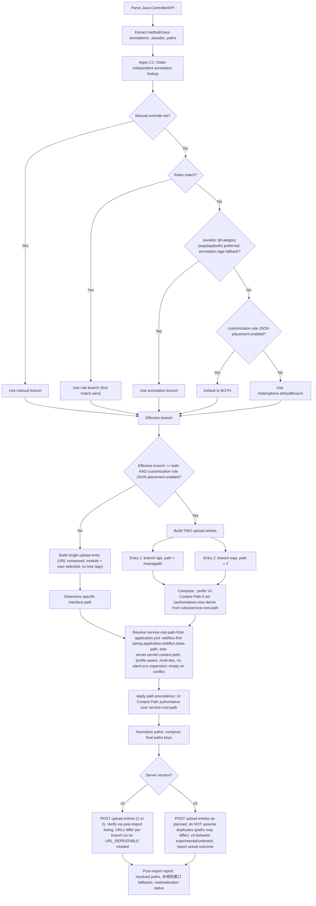

# MeterSphere VSCode Extension

VSCode extension for interacting with [MeterSphere](https://github.com/metersphere/metersphere) v2.x APIs — browse projects, sync Java Spring controllers, debug API requests, and manage test resources from your editor.

## Features

### 🔐 Authentication & Connection
- Token-based auth via Access Key / Secret Key (stored in VSCode settings)
- Connection status indicator (Connected/Disconnected/Connecting) in the sidebar
- `MeterSphere: Test Connection` command to validate credentials

### 🧭 Navigator (TreeView)
- Browse MeterSphere workspaces → projects → modules in the VSCode sidebar tree
- API endpoints shown under each module
- Selection auto-saves `workspaceId` / `projectId` to settings
- Refresh button in the view title bar

### 🎛️ Control Panel (WebView)
Single accordion-panel view with four panels:

| Panel | Description |
|-------|-------------|
| **Environment** | View and manage MeterSphere environments |
| **History** | Recent sync/upload history |
| **Sync** | Upload Java controllers to MeterSphere with module selection, import mode, context path, export name, and test case sync options |
| **Settings** | Configure URL, credentials, debug mode, connection test |

### 🐞 API Debugger
Standalone WebView for debugging MeterSphere API requests (1:1 parity with IDEA plugin):
- Select HTTP method, enter endpoint path and body
- Send requests and view responses
- Works as a separate panel or within the Control Panel

### ⬆️ Sync Operations
Sync Java Spring Controllers (`@RestController` / `@Controller`) to MeterSphere:

| Trigger | Scope |
|---------|-------|
| Right-click single `.java` file | That file only |
| Right-click multiple files/folders | Each `.java` file uploads directly, each folder is scanned recursively; results merged and deduped |
| Right-click folder | Recursive scan for controllers |
| Inline button on `.java` file | "This file" vs "Parent folder" dialog |
| Right-click Navigator project | Recursive scan of project |
| Sync panel "Select Java Files" button | File picker |

### 📋 Context Menus
- **Editor context**: Right-click in a Java file → upload to MeterSphere
- **File Explorer context**: Right-click `.java` file(s) or folders → upload
- **Navigator context**: Right-click project → scan and upload
- **View title bar**: Refresh, Environment, History, Sync, Settings, Debugger buttons

## Requirements

- VSCode ^1.80.0
- Node.js (for development)

## Installation

### From VSIX
```bash
code --install-extension metersphere-vscode-extension-0.2.0.vsix
```

### From source
```bash
git clone <repo>
cd metersphere-vscode-plugin
npm install
npm run compile
code --install-extension path/to/generated.vsix  # or symlink out/ to your extensions dir
```

## Configuration

| Setting | Default | Description |
|---------|---------|-------------|
| `metersphere.msUrl` | `http://localhost:8081` | MeterSphere server URL |
| `metersphere.accessKey` | `""` | Access Key (from User Settings → Token) |
| `metersphere.secretKey` | `""` | Secret Key (from User Settings → Token) |
| `metersphere.workspaceId` | `""` | Workspace ID (auto-synced from Navigator) |
| `metersphere.projectId` | `""` | Project ID (auto-synced from Navigator) |
| `metersphere.debugEnabled` | `false` | Enable debug logging to Output panel |
| `metersphere.exportFormat` | `swagger2` | Upload document format (`swagger2` = OpenAPI 3.0, `postman` = Postman collection) |
| `metersphere.rejectUnauthorized` | `true` | Reject self-signed TLS certificates |
| `metersphere.rulesPath` | `.metersphere/rules.json` | Workspace-relative path to the runtime rules JSON (branch/placement routing) |
| `metersphere.defaultBranch` | `eapi` | Fallback branch when no override/rule/@category/tag matches (`eapi`/`iapi`/`none`) |
| `metersphere.serverVersion` | `auto` | Server version for the upload payload (`auto` probes `/system/version/current`; `v3` is experimental/untested) |

## Commands

| Command | Title | Icon |
|---------|-------|------|
| `metersphere.showDebugger` | MeterSphere: Show Debugger | `$(debug)` |
| `metersphere.refreshNavigator` | MeterSphere: Refresh Navigator | `$(refresh)` |
| `metersphere.openNavigator` | MeterSphere: Open Navigator | — |
| `metersphere.prefillFromNode` | MeterSphere: Prefill from Node | — |
| `metersphere.configure` | MeterSphere: Configure | — |
| `metersphere.testConnection` | MeterSphere: Test Connection | — |
| `metersphere.statusBarMenu` | MeterSphere: Status Bar Menu | — |
| `metersphere.toggleDebug` | MeterSphere: Toggle Debug Mode | — |
| `metersphere.uploadFromEditor` | MeterSphere: Upload to MeterSphere | — |
| `metersphere.uploadFromFileExplorer` | MeterSphere: Upload to MeterSphere | — |
| `metersphere.syncFolder` | MeterSphere: Sync Folder | — |
| `metersphere.showEnvironment` | MeterSphere: Show Environment | `$(globe)` |
| `metersphere.showHistory` | MeterSphere: Show History | `$(history)` |
| `metersphere.showSettings` | MeterSphere: Show Settings | `$(gear)` |
| `metersphere.showSync` | MeterSphere: Show Sync | `$(sync)` |
| `metersphere.syncToMs` | MeterSphere: Sync to MeterSphere | — |
| `metersphere.uploadFromNavigator` | MeterSphere: Upload to MeterSphere | — |

## Usage

### 1. Configure credentials
Open **Control Panel → Settings** or run `MeterSphere: Configure`. Set `msUrl`, `accessKey`, and `secretKey`. Use `Test Connection` to verify.

### 2. Browse projects
The **Navigator** tree auto-loads workspaces and projects. Select a workspace/project to set context.

### 3. Sync Java files
Right-click a `.java` file or folder in the File Explorer → **MeterSphere: Upload to MeterSphere**. The Sync panel opens with scanning progress, lets you select a module and configure options, then upload.

### 4. Debug APIs
Run `MeterSphere: Show Debugger` — select method, enter path and body, execute against your MeterSphere instance.

## Branch Routing (eapi / iapi)

Each synced API is routed into an `eapi` or `iapi` branch. The branch is expressed in the **URL shape only** — the module is always the one you pick in the Sync panel (no module-tree manipulation).

**How the API path is decided:**



**Resolution order (first match wins):**
1. Manual **Branch** selector in the Sync panel (`auto` | `eapi` | `iapi` | `both` | `none`)
2. Runtime rules from the customization rule JSON — file location configured by `metersphere.rulesPath` (default: `.metersphere/rules.json`, workspace-relative) — entries `{ "matchOn": "methodAndPathPrefix|pathRegex|className|javadocCategory|annotationTag|catchAll", "pattern": "...", "branch": "eapi|iapi|both" }`, first match wins, `catchAll` evaluated last
3. Javadoc `@category eapi|iapi|both` (preferred marker; method-level overrides class-level)
4. Annotation tags (`@Operation(tags = {"iapi"})`)
5. `metersphere.defaultBranch` — or `both` when placement is enabled in the rules file

**Dual upload:** when the effective branch is `both` (and placement is enabled), the plugin uploads TWO documents to the same module: the iapi copy's paths are prefixed with `placement.managedPrefix` (default `/managed`), the eapi copy stays plain — e.g. `/managed/<service-root-path>/<path>` and `/<service-root-path>/<path>`. The differing URLs satisfy MeterSphere's method+path dedup without URL_REPEATABLE.

**Path precedence:** the manual Context Path field is authoritative; when empty, the service root path is auto-detected from `application.yml` (webflux-first `spring.application.webflux.base-path`, else `server.servlet.context-path`; profile-aware; `${ENV_VAR}` placeholders are never silently expanded).

**Server versions:** `metersphere.serverVersion` `auto` probes `GET /system/version/current` (200 = v3, 404 = v2). **v3 is experimental/untested** — the plugin reports actual post-import outcomes instead of assuming duplicate rows.

> Parser note: parsing is CST-first with a deterministic regex fallback — see the [Parser](#parser) section.

## Sync Flow

```
1. User triggers sync (file/folder/project)
2. Sync WebView opens → "Scanning..." state
3. Module/project dropdowns enabled during scan
4. Upload button shows "Scanning..." (disabled)
5. Background scan discovers @RestController classes
6. Scan done:
   - Files found → Upload button enabled, files listed
   - No files → Error shown, upload stays disabled
7. User selects module, options (import mode, context path, export name, sync test cases)
8. User clicks "Upload to MeterSphere"
```

## Development

```bash
npm install                    # Install dependencies
npm run compile                # TypeScript compile → out/
npm run watch                  # Watch mode
npx tsc -p tsconfig.json --noEmit   # Type-check only
npx eslint "src/**/*.{ts,tsx}"      # Lint
npm test                       # Run all Jest tests
npx jest --verbose              # Verbose test output
npx jest test/<file>.test.ts    # Run specific test
node test/<file>.test.js        # Run legacy Node tests
```

Tests use a mock VSCode stack: `src/vscode.d.ts` and `test/vscode-mock-setup.js`.

## Project Status

| Phase | Status | Notes |
|-------|--------|-------|
| Phase 1 MVP1 | ✅ Complete | TokenManager, HttpClient, SettingsManager, WebView scaffold, Jest |
| Phase 2 | ✅ Complete | Navigator TreeView, on-demand sync |
| Phase 3A | ✅ Complete | Sync upload, Environment/History panels |
| Phase 3B | ✅ Complete | Mocks, test data |
| Phase 3C | ✅ Stub Complete | DebugLogger only (telemetry deprecated) |
| Phase 4 | ✅ Complete | Context menus, Settings enhancements, testConnection, syncCases |
| Phase 4 Enhancement | ✅ Complete | Inline sync button, scan scope dialog, scanning UI, parallel module selection |
| Phase 5 | ✅ Complete | API Debugger (1:1 with IDEA plugin) |
| Sidebar Migration | ✅ Complete | 4 webviews → single Control Panel, accordion panels |
| API Endpoints in Navigator | ✅ Complete | API definitions under modules |
| Debugger Polish & Integration | ✅ Complete | VSCode theme CSS, message queuing, upload duplication guard |
| Header/Naming Fixes | ✅ Complete | @RequestHeader propagation, API naming precedence (Operation > Javadoc > path) |
| Java Parser (dual engine) | ✅ Complete | CST-first dispatch (`javaParserDispatch.ts`) with deterministic regex fallback; shared dual-engine expectation gate |
| Sync Name/Path/Branch Routing | ✅ Complete | Order-independent annotation lookup; context path in both formats; runtime rules JSON; `@category`-preferred eapi/iapi/both routing with dual upload; version probe + post-import verification; v3 experimental/untested |

## Recent Fixes

| Fix | Details |
|-----|---------|
| Full-spec OpenAPI export | Responses now carry real status codes (`@ResponseStatus`) + body schemas (wrapper types like `Response<Page<T>>` unwrap to the payload), parameters emit description/default/validation (javadoc `@param` + bean-validation annotations), DTO fields keep their constraints, enums/records/interfaces and `Map<K,V>` are modeled, `@PreAuthorize`-style auth becomes a bearer-JWT `securityScheme`, operations get `operationId` + `tags`, and DTOs from non-uploaded files are resolved via an async pre-pass (OpenAPI format only). `format` hints limited to `date-time`/`uuid`. See `docs/superpowers/specs/2026-10-15-openapi-spec-coverage.md`. |
| Security & robustness hardening | 52 code-review findings fixed across 14 themes: webview HTML/JS escaping + credentials no longer embedded in the DOM, request timeouts via `AbortController`, navigator no longer caches failed discovery, stable 16-byte AES key/IV derivation for any credential length, per-file upload error isolation, command status lifecycle (never stranded on "Connecting"), mixed multi-select sync (files + folders classified per URI), regex-parser parity with the CST parser (class-level `basePath`, method-scope detection, `@RequestBody` bound to the parameter list), OpenAPI security schemes always registered, per-upload type-index isolation, varargs parameters parsed, VSIX packaging slimmed (2284 → 272 files). Verified live against MeterSphere v2.10.26-lts: signature auth, exportName → server module, imported API paths. 35 suites / 535 tests. |
| Multipart + cookie params | `@RequestPart`/`MultipartFile` params export as `multipart/form-data` with per-part schemas; `@CookieValue` exports as `in: cookie`. |
| API naming precedence | `@Operation(summary)` > first Javadoc line > API path. Removed `@ApiOperation` as a naming source. |
| Header propagation | `@RequestHeader` names now export into Postman/MeterSphere request headers instead of being dropped. |
| Javadoc enrichment | `enhanceWithJavadoc` only fills summary when one is missing, preserving explicit `@Operation(summary)`. |
| Tests | Updated to verify header extraction and naming precedence across parser paths and export logic. All pass. |

## Parser

Java sources are parsed by **two engines behind one dispatcher** (`src/metersphere/javaParserDispatch.ts`):

1. **CST engine (primary)** — `src/metersphere/javaAst/` built on the vendored `java-parser` bundle (`vendor/java-parser.cjs`, rebuilt via `scripts/build-cst-vendor.mjs`): full syntax-tree parsing of controllers, annotations (nested + escaped strings), parameters (varargs-aware, Spring required semantics), and Javadoc.
2. **Regex engine (fallback)** — `src/metersphere/javaParser.ts`, used only when the CST throws (malformed Java) or returns zero APIs while the source still declares a controller annotation (a suspicious empty). A zero-API result on a non-controller file is a correct empty, not a fallback. Every fallback is logged with its reason — never silent. The regex engine uses order-independent annotation lookup (windowed nearest-annotation, paren-depth-aware capture, string-literal/comment masking), so `@Operation` is found whether it sits above or below `@GetMapping`.

**Dual-engine equivalence gate:** `test/javaParser.test.ts` holds a shared expectation table where every row runs against **both** engines (`parseJavaWithEngine('cst' | 'regex')`) and must produce identical results — including annotation-order rows proving order-independent lookup on both engines.

## Architecture

```
src/
  extension.ts                  # Top-level extension entry
  vscode.d.ts                   # VSCode API type declarations (mock-friendly)
  metersphere/
    extension.ts                # Extension bootstrap, view providers, activation
    tokenManager.ts/js          # Token persistence via VSCode settings
    settingsManager.ts          # Workspace/project ID persistence
    httpClient.ts/js            # HTTP client with token injection
    connectionManager.ts        # Connection state tracking
    commandRouter.ts            # Command registration and dispatch
    webviewController.ts        # WebView-based API debugger
    navigatorEngine.ts          # Tree data fetching (workspaces → projects → modules → APIs)
    navigatorTreeProvider.ts    # VSCode TreeDataProvider for Navigator
    syncEngine.ts               # Controller scanning and sync logic
    syncService.ts              # Sync upload service
    javaFileScanner.ts          # Java file discovery
    javaParser.ts               # Java annotation parser (regex engine)
    javaParserDispatch.ts       # CST-first dispatch with regex fallback
    scanLifecycle.ts            # Scan guard: exactly one terminal scanComplete per scan
    uploadParsing.ts            # Upload parse orchestration + OpenAPI DTO pre-pass
    typeResolver.ts             # Return-type extraction + type registry
    openApiBuilder.ts           # OpenAPI 3.0 document assembly
    validationSchema.ts         # Bean-validation constraints -> JSON Schema keywords
    uploadPlatform.ts           # Server platform mapping (OpenAPI ships as "Swagger2")
    variableResolver.ts         # {{var}} environment variable resolution
    escapeHtml.ts               # Webview HTML/JS escaping helpers
    contextPathResolver.ts      # Context-path detection from application.* (prefill only)
    serviceRootPathResolver.ts  # Webflux-first service root path detection
    rulesLoader.ts              # Runtime rules JSON loading (branch/placement routing)
    categoryResolver.ts         # eapi/iapi/both branch resolution chain
    versionProbe.ts             # Server version probe (v2/v3 payload shape)
    contextHolder.ts            # Global extension context holder
    debugLogger.ts              # Debug logging to Output panel
    authHeader.js               # Auth header generation
    retry.js                    # Retry utility
    math.js                     # Math utilities
    javaAst/                    # CST parser stack (java-parser / Chevrotain based)
      cstJavaParser.ts          # CST controller/method parser (primary engine)
      annotationReader.ts       # Annotation values: nested annotations, string escapes
      cstParamParser.ts         # Parameter extraction (varargs-aware, Spring required semantics)
      projectSymbolIndex.ts     # LSP/disk type resolution for cross-file DTOs
      javadocIndex.ts           # Javadoc comment index (@param, summaries)
      cstWalk.ts                # CST tree walking helpers
      loadJavaParser.ts         # Vendored java-parser loader
    models/
      navigatorNode.ts          # Tree node types (workspace/project/module/api)
      apiTemplate.ts            # API definition template
    views/
      sidebarView.ts            # Control Panel HTML and message handling
test/
  tokenManager.test.ts          # TokenManager tests
  httpClient.test.ts            # HttpClient tests
  commandRouter.test.ts         # CommandRouter tests
  connectionManager.test.ts     # ConnectionManager tests
  extension-bootstrap.test.ts   # Extension bootstrap tests
  javaParser.test.ts            # Java parser tests
  navigatorEngine.test.ts       # NavigatorEngine tests
  navigatorTreeProvider.test.ts # NavigatorTreeProvider tests
  syncEngine.test.ts            # SyncEngine tests
  syncService.test.ts           # SyncService tests
  models/                       # Model tests
  vscode-mock-setup.js          # Global vscode mock for Jest
docs/superpowers/
  specs/                        # Design specifications per phase
  plans/                        # Implementation plans per phase
```
